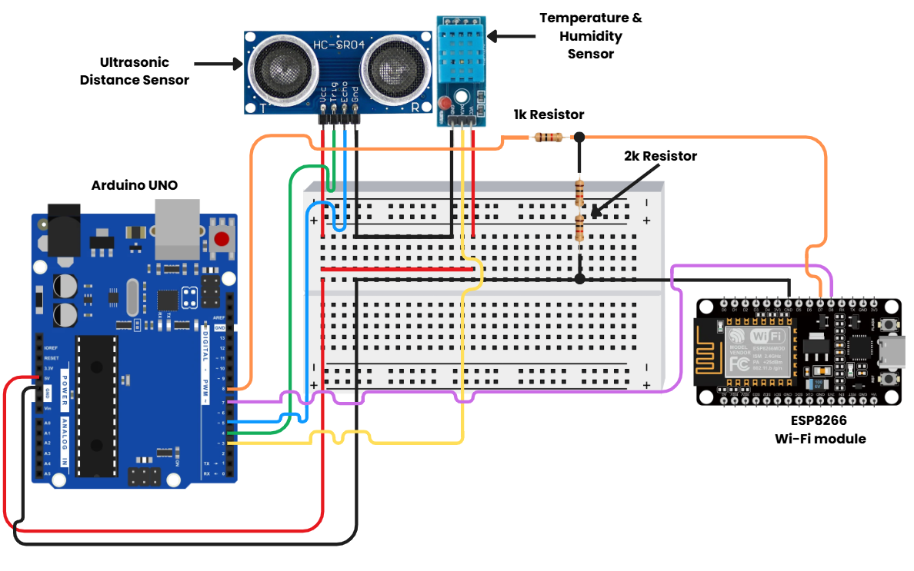
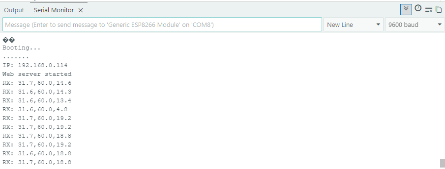
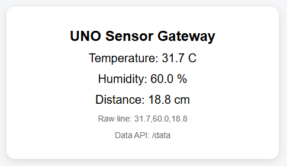

# 📡 Arduino UNO IoT Gateway

> An IoT monitoring system where an **Arduino Uno** reads temperature, humidity and distance and sends them to a **NodeMCU ESP8266**, which shows the live readings on a **Wi‑Fi web dashboard**.


<p align="center">
  
</p>

---

## 📖 Overview

This is an IoT monitoring system built around two boards:

- The **Arduino Uno** reads a **DHT11** temperature and humidity sensor and an **HC-SR04** ultrasonic distance sensor.
- The **NodeMCU ESP8266** receives those readings over serial, connects to Wi‑Fi and hosts a small **web server**. Anyone on the same network can open its IP address in a browser to see the live values.

A relay module can be added for automatic control based on the sensor readings.

## ✨ Features

- 🌡️ Reads **temperature and humidity** with a DHT11
- 📏 Measures **distance** with an HC-SR04 ultrasonic sensor
- 🔁 Sends data from the **Uno to the NodeMCU** over serial, with a voltage divider that keeps the 5 V signal at a safe 3.3 V
- 🌐 Serves a **live web dashboard** that refreshes every 2 s
- 🔌 Offers a simple **plain-text API** at `/data`
- ⚡ Can drive a relay for automation

## ⚙️ How It Works

```text
DHT11 ─┐
       ├─► Arduino Uno ──(SoftwareSerial 9600 baud, "temp,hum,dist")──► NodeMCU ESP8266 ──Wi-Fi──► Browser
HC-SR04┘                     via 1k / 2k voltage divider                  (web server :80)
```

1. Every 2 seconds the Uno reads the DHT11 and HC-SR04 and sends a line such as `31.7,60.0,18.8`.
2. The NodeMCU splits the line into temperature, humidity and distance.
3. Opening `http://<nodemcu-ip>/` shows the dashboard, and `http://<nodemcu-ip>/data` returns:
   ```
   temperature=31.7,humidity=60.0,distance=18.8
   ```

## 🧰 Components

| Item | Qty | Notes |
|---|:---:|---|
| Arduino Uno | 1 | Main sensor reader |
| NodeMCU ESP8266 | 1 | Wi‑Fi + web dashboard |
| DHT11 sensor | 1 | Temperature and humidity |
| HC-SR04 ultrasonic sensor | 1 | Distance measurement |
| Breadboard | 1 | For wiring |
| Jumper wires | 15–20 | Male-to-male and/or male-to-female as needed |
| 1 kΩ resistor | 1 | Upper leg of the serial voltage divider |
| 1 kΩ resistors | 2 | Wired in series to make the 2 kΩ lower leg |
| USB cable for Uno | 1 | Power + programming |
| Micro-USB cable for NodeMCU | 1 | Power + programming |
| 10 kΩ resistor | 1 | Only needed if your DHT11 is a bare sensor without a pull-up |

## 🔌 Wiring

| From | To | Purpose |
|---|---|---|
| Uno 5V | DHT11 VCC | Power sensor |
| Uno GND | DHT11 GND | Common ground |
| Uno D3 | DHT11 DATA | Read temperature/humidity |
| Uno 5V | HC-SR04 VCC | Power sensor |
| Uno GND | HC-SR04 GND | Common ground |
| Uno D4 | HC-SR04 TRIG | Trigger ultrasonic pulse |
| Uno D5 | HC-SR04 ECHO | Read echo pulse |
| Uno GND | NodeMCU GND | Shared ground between boards |
| Uno D7 | NodeMCU D8 / TX | Uno receives from NodeMCU |
| Uno D8 | 1 kΩ resistor | Start of voltage divider from Uno TX |
| Junction point | NodeMCU D7 / RX | Safe 3.3 V serial input to NodeMCU |
| Junction point | 2 kΩ to GND | Lower leg of divider |
| NodeMCU USB | PC USB | Upload code + power NodeMCU |

### Voltage divider (5 V → 3.3 V)

```text
Uno D8 (TX) --- 1k ---+--- NodeMCU D7 (RX)
                      |
                      2k   (two 1k in series)
                      |
                     GND
```

## 🚀 Getting Started

1. **Install libraries** in the Arduino IDE:
   - *DHT sensor library* by Adafruit (and *Adafruit Unified Sensor*)
   - The **ESP8266 board package**, added through Boards Manager
2. **Upload to the Arduino Uno:** [`uno_sensor_reader/uno_sensor_reader.ino`](uno_sensor_reader/uno_sensor_reader.ino)
3. **Upload to the NodeMCU:** [`nodemcu_gateway/nodemcu_gateway.ino`](nodemcu_gateway/nodemcu_gateway.ino)
   - First set your Wi‑Fi `ssid` and `password`. The NodeMCU only works on **2.4 GHz** networks.
4. Open the NodeMCU **Serial Monitor** at 9600 baud and note the IP address it prints.
5. Open `http://<that-ip>/` in a browser on the same network.

## 📊 Output

**Serial monitor on the NodeMCU**



**Web dashboard**



## 💡 Applications

- Home automation
- Security and intrusion detection
- Environmental monitoring
- Smart monitoring for small projects and labs

## 📂 Project Structure

```text
arduino-uno-iot-gateway/
├── uno_sensor_reader/
│   └── uno_sensor_reader.ino   # Arduino Uno: DHT11 + HC-SR04 -> serial
├── nodemcu_gateway/
│   └── nodemcu_gateway.ino     # NodeMCU: serial -> Wi-Fi web server
├── images/                     # circuit diagram and output screenshots
└── README.md
```

## ✅ Conclusion

This project shows the basics of IoT: interfacing sensors, communicating between microcontrollers and accessing data over Wi‑Fi. It's a beginner-friendly way to learn real-time monitoring and web-based data display.

## 👤 Author

**Melbin Manoj** — [GitHub](https://github.com/MelbinManoj) · [LinkedIn](https://www.linkedin.com/in/melbin-manoj-8ba512269/)
